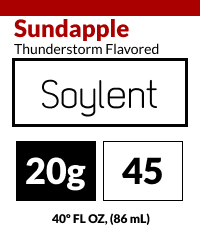

# Soyface

A PebbleOS watchface for four platforms styled as a Soylent bottle, the soyboys and soydevs and soykiddos and soygals and everyone in between can enjoy this beautiful watchface, i made this cause i was talking with my friend burger 10 thousand (he's neiche ball knowledge ebk I'm totally not adding this for the green github square to look more active...), and i wanted to make a watchface for him, as he is a big fan of soy. also to make fun of him for it, its a win win situation am i right. also check the settings on the phone, he is there. (burger 10 thousand), soylent is the nectar of the gods. you should try it.

pretty cool huh :P

  

## No native fonts its just baked bitmap atlases

i hate fonts so i baked them into the generated C files using ms paint (in a virtual machine of windows 7 on a chromebook). 

i dont even know if this is legal since its a copyrighted font, if it isn't, then the lawyers can come get me. 

anyway, this is what happens when you let unfunny people make watch faces. 

hi im henry and i own a smart watch and i love to make terrible watch faces. 

## Build & install

do you not know?
Real Men Dont need instructions. - TIL Home Improvement for the SNES
cant be bothered to write out instructions. 
just type "pebble build" and it spits out the app.

## Configuration (phone)

yeah well you also need a web server if you want to customize it, and you need to manually install the web server on your phone. good luck with that. 

if you use a static host it might work though.

## Weather

i dont even remember what api this uses lol 💀

maybe it uses openweather, or maybe it uses wttr.in? (i like wttr.in go check it out)

i forget.

wait no it uses openmeteo! i knew i was smart

## Animations
bowser fart gif level of genius

  

looks like this btw.

who even finds this attractive? i dont get it? its just poop?? LMAO

## henry doesnt care about old pebbles

this watchface is for the good pebbles and not the black and white ones, any pebble that has a color screen is good, anything else is bad. so yeah if it doesnt work on your pebble then screw you. im a incompitent developer and i dont care about the old pebbles. get a new pebble lmao. 

## disclaimer

dont use an ai to help you with this watchface. if you do, i will be very sad. :(
also dont use ai to make a pr or i will be very sad. :( (if you use ai to make a pr, i will literally cry)
i dont even know if this is legal since its a copyrighted font, if it isn't, then the lawyers can come get me. 
uhm i forgor💀 

if you read this whole thing, you are also a soyboy, congratulations. 
if your offended by being called soy and think that soy is a good thing, soy has its downsides: cancer, gynomcostia, uhm uhm diddy poopy, so soy is bad.

if you ask for the time to automatically choose 24 hr or 12 hour based on the language settings of the phone, i will ignore you, this is not a feature im adding. and if you complain about it, i will send pinkpantheress to your house and she will steal your kneecaps.
